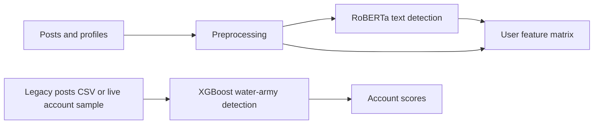
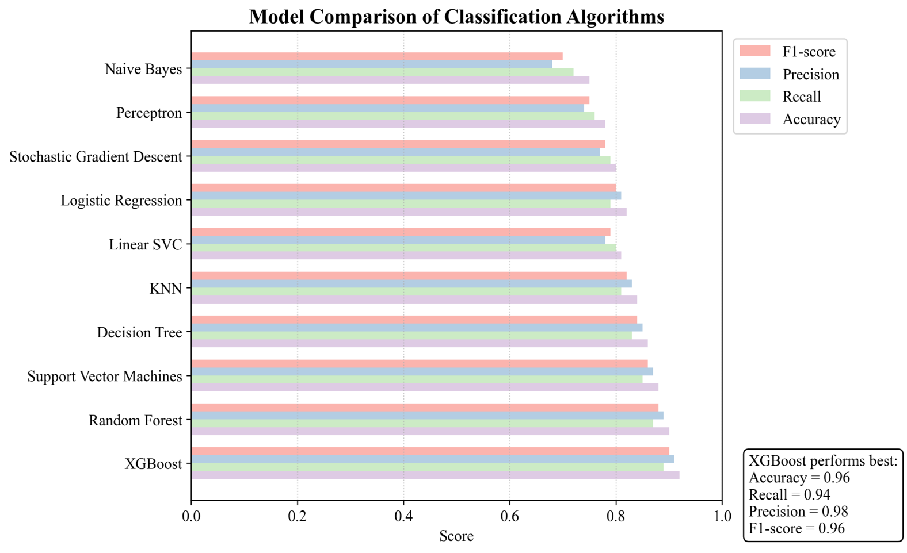
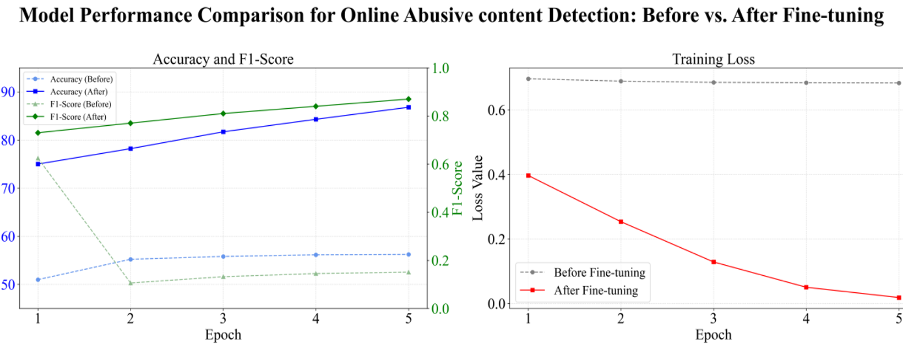

# Identifying and Characterizing Disruptive User Roles on Social Media

**Weibo research prototype** · Data collection, Chinese abusive-text detection and account-level feature extraction.

**English** | [简体中文](README_zh.md) | [日本語](README_ja.md)

Run `python -m streamlit run app.py --server.port 8502` from the repository root, then open the [local Streamlit demo](http://127.0.0.1:8502/).

> Research project by Huiyu Jiang. For academic use only.

- **Cyber Water Army** [1]. Coordinated and inauthentic groups of accounts acting in concert.
- **Cyber Trolls** [2]. Independent users engaging in malicious, personal attacks.

## Research workflow

Coordinated amplification and targeted personal attacks can intensify online harassment during public controversies. This Weibo case study uses multiple dimensions of evidence to identify and characterize two account roles, cyber water armies and cyber trolls. The aim is to understand how harassment spreads and inform platform moderation.



| Feature dimension | Examples |
|---|---|
| Content | Abusive-post ratio, text similarity, mentions and links |
| Network structure | Degree centrality in the interaction network |
| Behavior | Repost-to-original-post ratio |
| Profile | Following-to-follower ratio, Sunshine Credit, VIP level and digits in screen names |

## Research results · Fat Cat incident on Weibo

The proposed multiclass XGBoost setup uses coordination and personal attacks as distinct signals. Each UID needs one resolved label: cyber water army, cyber troll, or other. Review overlapping accounts under a predefined rule before assigning a single label.

| Manual annotation task | Positive | Negative |
|---|---:|---:|
| Cyber water army | 200 | 400 |
| Cyber troll | 40 | 80 |

These counts describe two annotation tasks. To build a multiclass dataset, join the labels by UID and verify both roles before assigning the other class. A negative label for one role leaves the other role open. Both tasks have a 1:2 positive-to-negative ratio, but the troll task has one fifth as many positive examples. Its precision, recall and F1 estimates are therefore more sensitive to individual predictions. Report support and metrics by class alongside macro F1. [1] and [2] refer to Nian et al. and Swed et al., respectively.

The selected model was then applied to the full corpus of **21,963 posts from 11,581 users**.

| Account role | Suspected accounts in the full corpus |
|---|---:|
| Cyber water army | **1,392** |
| Cyber troll | **145** |

The supplied model comparison ranks XGBoost highest among the evaluated classifiers. The figure's annotation reports accuracy **0.96**, precision **0.98**, recall **0.94**, and F1 **0.96**.



## Implementation status

| Component | Status |
|---|---|
| Post and profile collection | Code included |
| Chinese RoBERTa text detection | Training, batch inference and Streamlit demo included |
| User-level features | Content, interaction network, behavior and profile |
| XGBoost water-army detection | Implemented in [src/water_army.py](src/water_army.py) with training, held-out evaluation, and batch prediction. |
| Research comparison of account roles | Results summarized above |

The next steps are to define annotation criteria, manually review account labels, split training and evaluation data by UID, and report per-class precision, recall and F1. If detector scores are used as features, evaluation should use independent human labels.

## Run the XGBoost water-army baseline

Keep both input files locally, for example as `data/raw/legacy_posts.csv` (the legacy Weibo export with Chinese column names) and `data/raw/labels.csv` (with `uid` and `bot`). Run from the repository root:

```bash
pip install "xgboost>=2" pandas scikit-learn networkx
python src/water_army.py train --posts data/raw/legacy_posts.csv --labels data/raw/labels.csv --model models/water_army.json
python src/water_army.py predict --posts data/raw/legacy_posts.csv --model models/water_army.json --out data/raw/water_army_predictions.csv
```

Training aggregates posts by UID, excludes blank labels, rejects conflicting labels, and writes a model and `water_army.metrics.json`. Prediction writes `uid,bot,bot_score` per account. Set `--threshold` to change the default cutoff of 0.5.

The baseline uses historical `bot` values as reference labels and excludes `bot_score` from the features. Held-out metrics measure agreement with historical labels. Estimating real-world detection accuracy requires independently reviewed labels.

Run `python -m streamlit run app.py` and enter a numeric Weibo UID in the account scoring form. Upload a legacy posts CSV for offline scoring, or configure `WEIBO_COOKIE` in the local `.env` to request one timeline page. The crawler stops when Weibo requires login or verification or limits access. The app loads `models/water_army.json` by default, with `WATER_ARMY_MODEL` as an override. Live timeline samples differ from the historical training window.

After configuring your own Weibo session, check that the crawler can read the account profile and one page of posts. Replace the example UID with your target.

```bash
python src/crawler/user_profile_crawler.py --check-uid 1234567890
```

The legacy posts CSV uses the original Chinese column names. The topic crawler below produces a different schema.

## Repository structure

```
├── app.py                      # Streamlit: account scoring and text detection
├── requirements.txt
├── .env.example                # copy to .env, fill in your own cookie
├── data/README.md              # where to get the training corpora
└── src/
    ├── preprocess.py           # shared text cleaning (training = inference)
    ├── utils.py                # ID hashing for anonymization
    ├── features.py             # builds the user feature matrix
    ├── water_army.py           # XGBoost
    ├── crawler/
    │   ├── weibo_crawler.py
    │   └── user_profile_crawler.py
    └── abuse_detector/
        ├── train.py            # fine-tune RoBERTa
        ├── detector.py         # batch inference
        └── predict_csv.py      # score a crawled CSV
```

## Quick start

```bash
pip install -r requirements.txt
cp .env.example .env            # set WEIBO_COOKIE (your own account) and ANON_SALT
```

**1. Crawl posts and profiles** (keep raw output private; it is git-ignored)

```bash
python src/crawler/weibo_crawler.py --keyword "<topic>" \
    --start "2024-05-03 19:00" --end "2024-05-03 20:00" --max-pages 20 --out data/raw/topic_posts.csv
python src/crawler/user_profile_crawler.py --in data/raw/topic_posts.csv --out data/raw/profiles.csv
```

**2. Score posts with the abuse detector**

```bash
python src/abuse_detector/predict_csv.py --model "models/cyberbullying_roberta" \
    --in data/raw/topic_posts.csv --out data/raw/posts_scored.csv
```

**3. Build the feature matrix**

```bash
python src/features.py --posts data/raw/posts_scored.csv \
    --profiles data/raw/profiles.csv --out data/features.csv
```

**4. (Optional) Run the demo**

```bash
python -m streamlit run app.py
```

Note: the interaction network is built from @mentions, which carry only screen names. Step 3 therefore needs data crawled *without* `--anonymize`. Run it locally, and publish only anonymized, aggregated outputs.

## Abuse detector

- **Base model:** `hfl/chinese-roberta-wwm-ext-large`, fine-tuned for binary classification (abusive / not abusive).
- **Corpora:** a merge of three public datasets, ToxiCN [1], COLD [2] and SWSR [3]. They are not redistributed here; see `data/README.md`.
- **Training setup:** AdamW, lr 5e-5, weight decay 0.01, 100 warmup steps, 5 epochs, batch size 32, max length 128; 8:1:1 stratified train/val/test split. The best epoch by validation F1 is kept, and the test set is used once at the end.
- **Metrics:** run `train.py`; it writes `training_log.json` and `test_metrics.json` next to the model.

```bash
python src/abuse_detector/train.py --data corpus.csv --out models/cyberbullying_roberta
```

RoBERTa defaults to `models/cyberbullying_roberta`. Set `ABUSE_MODEL` in your local `.env` to use another checkpoint directory or a compatible Hub model.

### RoBERTa fine-tuning and detection examples



| No. | Post summary | Reference | Prediction | Outcome |
|---:|---|---:|---:|---|
| 1 | Accuses a person of lying and being indifferent to another person's death | 1 | 1 | Detected |
| 2 | Insults a person and disparages them based on sexual orientation | 1 | 1 | Detected |
| 3 | Uses a derogatory reference and claims an allegation was proven | 1 | 1 | Detected |
| 4 | Accuses a person of concealing a relationship and flirting with others | 1 | 0 | Missed |

`1` denotes abusive text. `0` indicates no abusive-text flag.

## Data & ethics

- **No data is distributed.** Neither the crawled Weibo data nor the training corpus is included. Obtain the corpora from their original publishers and follow their terms.
- **Anonymization.** The crawlers can hash user IDs with a salt and drop nicknames and bios (`--anonymize`). Do not publish raw user-level data.
- **Credentials.** Cookies live in `.env` (git-ignored). Never commit them.
- **Platform rules.** Use only your own account and respect Weibo's terms of service, rate limits and applicable law. The crawlers are for academic research, not large-scale or commercial collection.
- **Responsible use.** Outputs are probabilistic. Do not use them to publicly label, harass or take action against individual accounts.

## Limitations

- One event on one platform; signatures and thresholds may not transfer.
- The abuse detector inherits the biases and annotation choices of its three corpora, and can misread sarcasm, quotation and reclaimed slurs.
- Repost/original ratio is estimated from a sample of each user's recent posts.
- The available detector labels describe the detector output on this sample.

## References

1. Lu, J., Xu, B., Zhang, X., et al. Facilitating Fine-grained Detection of Chinese Toxic Language: Hierarchical Taxonomy, Resources, and Benchmarks. *Proceedings of the 61st Annual Meeting of the ACL*, Toronto, Canada, 2023, vol. 1, pp. 16235–16250.
2. Deng, J., Zhou, J., Sun, H., et al. COLD: A Benchmark for Chinese Offensive Language Detection. *Proceedings of EMNLP 2022*, Abu Dhabi, UAE, pp. 11580–11599.
3. Jiang, A., Yang, X., Liu, Y., et al. SWSR: A Chinese Dataset and Lexicon for Online Sexism Detection. *Online Social Networks and Media*, 2022, 27:100182.
4. Nian, F., et al. A study on the propagation of online public opinion by internet water army. 2024.
5. Swed, O., et al. Keeping it authentic: the social footprint of the trolls' network. 2023.
