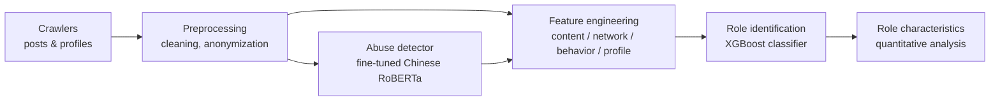

# Identifying and Characterizing Disruptive User Roles on Social Media

A multi-dimensional framework for identifying and distinguishing two kinds of disruptive users on Weibo: the **Cyber Water Army** (coordinated, inauthentic accounts acting in concert) and **Cyber Trolls** (independent users engaging in malicious personal attacks).

**English** | [简体中文](README_zh.md)

> Research project by Huiyu Jiang. For academic use only.

## Overview

Disruptive users harm online discourse and community health. Water-army accounts amplify and coordinate; trolls attack individuals. They are often lumped together, but they leave different behavioral traces. This project builds a pipeline that extracts features from four dimensions and uses them to tell the two roles apart.



### Feature dimensions

| Dimension | Features |
|---|---|
| Content | abusive content ratio, content similarity, @/link ratio |
| Network structure | degree centrality (and its percentile rank) |
| Behavior | repost-to-original post ratio |
| Profile | following/follower ratio, Sunshine Credit, VIP level, username digit ratio |

## Case study and findings

The framework was applied to one major public-opinion event on Weibo: **21,963 posts from 11,581 users**. It flagged **1,392 suspected water-army accounts** and **145 suspected troll accounts**. On the labeled data, the best classifier (XGBoost) reached accuracy 0.96, precision 0.98, recall 0.94 and F1 0.96, ahead of Naive Bayes, SVM, Random Forest, KNN and the other baselines compared.

The two roles showed different signatures (thresholds as observed in this one case study; they are descriptive, not universal rules):

| Feature | Cyber Water Army | Cyber Troll |
|---|---|---|
| Content | @/link ratio ≥ 1/3; content similarity ≥ 1/3 | abusive content ratio ≥ 1/2 |
| Degree centrality rank | 10%–50% | 50%–100% |
| Repost/original ratio | > 3 | ≥ 2 |
| Following/follower ratio | ≥ 10 | ≥ 2 |
| Sunshine Credit | ≤ 2 | < 4 |
| VIP level | 0 | – |
| Username digit ratio | ≥ 1/2 | < 1/2 |

"Suspected" is deliberate: these are statistical labels from behavioral patterns, not proof that any individual account is a paid or malicious actor.

## What is in this repository

| Component | Status |
|---|---|
| Post crawler (`src/crawler/weibo_crawler.py`) | Included |
| User profile crawler (`src/crawler/user_profile_crawler.py`) | Included |
| Abuse detector: training, batch inference, Streamlit demo | Included |
| Feature engineering (`src/features.py`) | Included |
| Role classifier (XGBoost training/evaluation) and role-characteristics analysis | **Not included yet.** Results above are from the study. |
| Raw data, labeled accounts, training corpus, model weights | **Not included** (see Data & ethics) |

The crawlers and `features.py` were refactored for publication and have been tested on synthetic data only. Weibo's web endpoints are undocumented and change; verify against a single user or one page before a larger run.

## Repository structure

```
├── app.py                      # Streamlit demo: single-sentence abuse detection
├── requirements.txt
├── .env.example                # copy to .env, fill in your own cookie
├── data/README.md              # where to get the training corpora
└── src/
    ├── preprocess.py           # shared text cleaning (training = inference)
    ├── utils.py                # ID hashing for anonymization
    ├── features.py             # builds the user feature matrix
    ├── crawler/
    │   ├── weibo_crawler.py
    │   └── user_profile_crawler.py
    └── abuse_detector/
        ├── train.py            # fine-tune RoBERTa
        ├── detector.py         # batch inference
        └── predict_csv.py      # score a crawled CSV
```

## Quick start

```bash
pip install -r requirements.txt
cp .env.example .env            # set WEIBO_COOKIE (your own account) and ANON_SALT
```

**1. Crawl posts and profiles** (keep raw output private; it is git-ignored)

```bash
python src/crawler/weibo_crawler.py --keyword "<topic>" \
    --start "2024-05-03 19:00" --end "2024-05-03 20:00" --max-pages 20 --out data/raw/posts.csv
python src/crawler/user_profile_crawler.py --in data/raw/posts.csv --out data/raw/profiles.csv
```

**2. Score posts with the abuse detector**

```bash
python src/abuse_detector/predict_csv.py --model <path-or-hub-id> \
    --in data/raw/posts.csv --out data/raw/posts_scored.csv
```

**3. Build the feature matrix**

```bash
python src/features.py --posts data/raw/posts_scored.csv \
    --profiles data/raw/profiles.csv --out data/features.csv
```

**4. (Optional) Run the demo**

```bash
ABUSE_MODEL=<path-or-hub-id> streamlit run app.py
```

Note: the interaction network is built from @mentions, which carry only screen names. Step 3 therefore needs data crawled *without* `--anonymize`. Run it locally, and publish only anonymized, aggregated outputs.

## Abuse detector

- **Base model:** `hfl/chinese-roberta-wwm-ext-large`, fine-tuned for binary classification (abusive / not abusive).
- **Corpora:** a merge of three public datasets, ToxiCN [1], COLD [2] and SWSR [3]. They are not redistributed here; see `data/README.md`.
- **Training setup:** AdamW, lr 5e-5, weight decay 0.01, 100 warmup steps, 5 epochs, batch size 32, max length 128; 8:1:1 stratified train/val/test split. The best epoch by validation F1 is kept, and the test set is used once at the end.
- **Metrics:** run `train.py`; it writes `training_log.json` and `test_metrics.json` next to the model. *(Fill in the final held-out test numbers here.)*

```bash
python src/abuse_detector/train.py --data corpus.csv --out models/cyberbullying_roberta
```

Model weights are hosted on the Hugging Face Hub *(add link)*, not in this repository.

## Data & ethics

- **No data is distributed.** Neither the crawled Weibo data nor the training corpus is included. Obtain the corpora from their original publishers and follow their terms.
- **Anonymization.** The crawlers can hash user IDs with a salt and drop nicknames and bios (`--anonymize`). Do not publish raw user-level data.
- **Credentials.** Cookies live in `.env` (git-ignored). Never commit them.
- **Platform rules.** Use only your own account and respect Weibo's terms of service, rate limits and applicable law. The crawlers are for academic research, not large-scale or commercial collection.
- **Responsible use.** Outputs are probabilistic. Do not use them to publicly label, harass or take action against individual accounts.

## Limitations

- One event on one platform; signatures and thresholds may not transfer.
- The abuse detector inherits the biases and annotation choices of its three corpora, and can misread sarcasm, quotation and reclaimed slurs.
- Repost/original ratio is estimated from a sample of each user's recent posts.
- Role labels reflect behavioral similarity to the labeled examples, not ground-truth intent.

## References

1. Lu, J., Xu, B., Zhang, X., et al. Facilitating Fine-grained Detection of Chinese Toxic Language: Hierarchical Taxonomy, Resources, and Benchmarks. *Proceedings of the 61st Annual Meeting of the ACL*, Toronto, Canada, 2023, vol. 1, pp. 16235–16250.
2. Deng, J., Zhou, J., Sun, H., et al. COLD: A Benchmark for Chinese Offensive Language Detection. *Proceedings of EMNLP 2022*, Abu Dhabi, UAE, pp. 11580–11599.
3. Jiang, A., Yang, X., Liu, Y., et al. SWSR: A Chinese Dataset and Lexicon for Online Sexism Detection. *Online Social Networks and Media*, 2022, 27:100182.
4. Nian, F., et al. A study on the propagation of online public opinion by internet water army. 2024.
5. Swed, O., et al. Keeping it authentic: the social footprint of the trolls' network. 2023.
