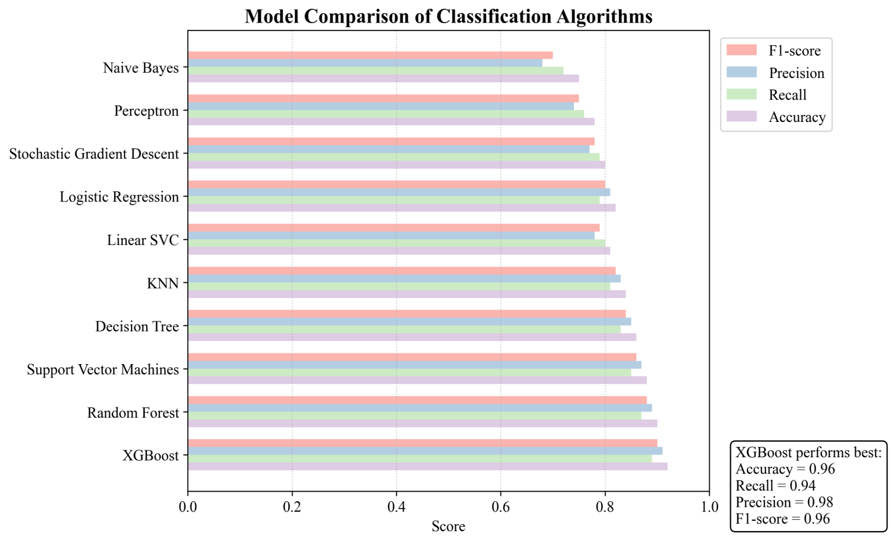
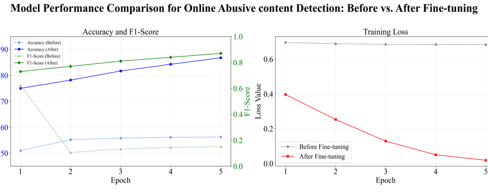

# ソーシャルメディアにおける有害なユーザー行動の識別と特徴分析

[English](README.md) | [简体中文](README_zh.md) | **日本語**

リポジトリのルートで `python -m streamlit run app.py --server.port 8502` を実行し、[ローカルの Streamlit デモ](http://127.0.0.1:8502/) を開きます。

Huiyu Jiang による微博（Weibo）の研究プロジェクトです。投稿とプロフィールの収集、中国語の攻撃的表現の検出、アカウント単位の特徴抽出を行います。アカウント分析では、組織的な拡散への関与が疑われるアカウント（中国語で「ネット水軍」）を対象とします。

- **ネット水軍（Cyber Water Army）** [1]。協調して行動する、真正性を欠くアカウントの集団。
- **サイバートロール（Cyber Trolls）** [2]。独立して悪意のある個人攻撃を行うユーザー。

## 実装内容

微博で社会的な関心が集まると、組織的な拡散や個人に対する攻撃によって、ネット上の嫌がらせが深刻化することがあります。本研究は、複数の観点からアカウントの特徴を捉え、組織的な拡散に関わる「水軍」と、個人への攻撃を繰り返すアカウントを識別・分析することを目的とします。攻撃が拡散する仕組みの理解や、プラットフォームの対策の検討に役立てます。

| 機能 | 内容 |
|---|---|
| データ収集 | トピック検索による投稿収集と、UID を指定したプロフィール・投稿の取得 |
| RoBERTa | 中国語の攻撃的表現を投稿単位で検出。学習、CSV 推論、Streamlit デモを提供 |
| 特徴抽出 | 投稿内容、交流ネットワーク、行動、プロフィールに関する特徴量を集計 |
| XGBoost | アカウント単位の学習、ホールドアウト評価、CSV 一括推論、Streamlit でのスコア表示 |

| 特徴量の観点 | 例 |
|---|---|
| 投稿内容 | 攻撃的な投稿の割合、テキストの類似度、メンションとリンクの割合 |
| ネットワーク構造 | 交流ネットワークの次数中心性 |
| 行動 | オリジナル投稿に対するリポストの比率 |
| プロフィール | フォロー数とフォロワー数の比率、陽光信用、VIP レベル、表示名に含まれる数字の割合 |

## 研究結果 · 微博の「胖猫事件」

多クラス分類の設計では、協調的な拡散と個人攻撃を異なる行動の手掛かりとし、単一の XGBoost モデルで水軍、サイバートロール、その他に分類します。各 UID に一つのラベルを付けます。両方に当てはまる場合は、事前に定めた基準で確認して分類します。

| 人手によるラベル付け | 正例 | 負例 |
|---|---:|---:|
| ネット水軍 | 200 | 400 |
| サイバートロール | 40 | 80 |

表は二つのラベル付け作業の件数です。多クラス分類用のデータを作る際は UID で統合し、両方の役割を確認してから「その他」を割り当てます。一方の負例がもう一方の正例に当たる場合もあります。正例と負例の比率はどちらも 1:2 ですが、トロールの正例は水軍の 5 分の 1 です。少数の予測の違いがトロールの適合率・再現率・F1 に影響しやすいため、クラス別の評価件数と指標をマクロ平均 F1 と併記します。[1] は Nian ら、[2] は Swed らの研究を指します。

選定したモデルを、**11,581 ユーザー**による **21,963 件の投稿**からなる全データに適用しました。

| アカウントの役割 | 全データで抽出された疑いのあるアカウント数 |
|---|---:|
| ネット水軍 | **1,392** |
| 個人への攻撃を繰り返すアカウント（サイバートロール） | **145** |

提供されたモデル比較図では、評価対象の分類器の中で XGBoost が最上位でした。図中の注記によると、正解率は **0.96**、適合率は **0.98**、再現率は **0.94**、F1 スコアは **0.96** です。



## セットアップとデモ

リポジトリのルートディレクトリで実行します。

```bash
pip install -r requirements.txt
python -m streamlit run app.py
```

- **XGBoost 水军风险** では、数字の微博 UID を入力し、旧形式の投稿 CSV をアップロードするとアカウントのスコアを表示できます。モデルは既定で `models/water_army.json` から読み込みます。別のモデルを使う場合はローカルの `.env` で `WATER_ARMY_MODEL` を設定してください。
- **RoBERTa 文本检测** では、中国語のテキストを入力してスコアを確認できます。既定の重みの場所は `models/cyberbullying_roberta` です。別の重みを使う場合は `.env` で `ABUSE_MODEL` を設定してください。

リアルタイム取得には、`.env.example` を参考にローカルの `.env` を用意し、自分の微博アカウントの Cookie を `WEIBO_COOKIE` に設定します。以下の数字を対象の UID に置き換えると、プロフィールと投稿 1 ページを取得できるか確認できます。

```bash
python src/crawler/user_profile_crawler.py --check-uid 1234567890
```

微博から再ログイン、追加認証、アクセス制限の応答があった場合は、CSV でスコアを計算できます。リアルタイム取得のサンプルと学習時の事例データでは収集期間が異なります。

## XGBoost の学習と一括推論

旧形式の投稿 CSV を `data/raw/legacy_posts.csv`、既存のラベル CSV を `data/raw/labels.csv` に配置します。投稿 CSV には「楼主ID」「话题内容」などの元の中国語の列名が必要です。ラベル CSV には `uid` と `bot` が必要です。トピック検索クローラーが出力する CSV は列の形式が異なります。

```bash
python src/water_army.py train --posts data/raw/legacy_posts.csv --labels data/raw/labels.csv --model models/water_army.json
python src/water_army.py predict --posts data/raw/legacy_posts.csv --model models/water_army.json --out data/raw/water_army_predictions.csv
```

同じ UID の投稿を集計してから学習用と評価用に分割します。学習時はラベルが空欄のアカウントを除外し、同じ UID に異なるラベルがある場合はエラーを返します。学習結果はモデルと `models/water_army.metrics.json` に保存されます。推論結果には `uid,bot,bot_score` が含まれ、`--threshold` で既定値 0.5 の判定しきい値を変更できます。

## RoBERTa の学習と投稿分析

基盤モデルは `hfl/chinese-roberta-wwm-ext-large` です。ToxiCN、COLD、SWSR の入手方法は [学習用コーパスの案内](data/README.md) を参照してください。

```bash
python src/abuse_detector/train.py --data corpus.csv --out models/cyberbullying_roberta
python src/abuse_detector/predict_csv.py --model models/cyberbullying_roberta --in data/raw/topic_posts.csv --out data/raw/posts_scored.csv
python src/features.py --posts data/raw/posts_scored.csv --profiles data/raw/profiles.csv --out data/features.csv
```

学習スクリプトは `training_log.json` と `test_metrics.json` を出力します。トピック投稿とプロフィールの収集手順は [英語版 README](README.md) を参照してください。

### RoBERTa のファインチューニング結果と検出例



| 番号 | 投稿の要約 | 正解 | 予測 | 結果 |
|---:|---|---:|---:|---|
| 1 | 当事者がうそをつき、他人の死を気にかけなかったと非難 | 1 | 1 | 検出 |
| 2 | 当事者を侮辱し、性的指向を引き合いに出して中傷 | 1 | 1 | 検出 |
| 3 | 当事者を侮蔑的に呼び、疑惑が裏付けられたと主張 | 1 | 1 | 検出 |
| 4 | 交際を隠し、別の相手と親密だったと非難 | 1 | 0 | 見逃し |

`1` は攻撃的な投稿、`0` は攻撃的と判定されなかった投稿を表します。

## データの取り扱い

投稿の生データ、アカウント別ラベル、学習用コーパス、モデルの重みはリポジトリに含まれていません。Cookie はローカルの `.env` に保存してください。公開する場合は匿名化した集計結果を使い、モデルのスコアは人手で確認する対象の選定に用いてください。

## 参考文献

1. Nian, F., et al. A study on the propagation of online public opinion by internet water army. 2024.
2. Swed, O., et al. Keeping it authentic: the social footprint of the trolls' network. 2023.
3. Lu, J., Xu, B., Zhang, X., et al. Facilitating Fine-grained Detection of Chinese Toxic Language: Hierarchical Taxonomy, Resources, and Benchmarks. *Proceedings of the 61st Annual Meeting of the ACL*, Toronto, Canada, 2023, vol. 1, pp. 16235–16250.
4. Deng, J., Zhou, J., Sun, H., et al. COLD: A Benchmark for Chinese Offensive Language Detection. *Proceedings of EMNLP 2022*, Abu Dhabi, UAE, pp. 11580–11599.
5. Jiang, A., Yang, X., Liu, Y., et al. SWSR: A Chinese Dataset and Lexicon for Online Sexism Detection. *Online Social Networks and Media*, 2022, 27:100182.
