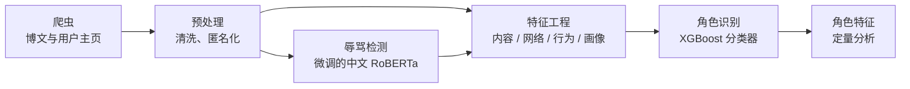

# 社交媒体破坏性用户角色的识别与刻画

一个多维度框架，用于在微博上识别并区分两类破坏性用户：**网络水军**（协同行动的非真实账号群体）和**网络喷子**（独立发起恶意人身攻击的用户）。

[English](README.md) | **简体中文**

> 作者：Huiyu Jiang。仅用于学术研究。

## 项目简介

破坏性用户会损害网络讨论和社区健康。水军负责放大和协同，喷子负责攻击个人。两者常被混为一谈，但行为痕迹并不相同。本项目构建了一条流程：从四个维度提取特征，并据此区分这两类角色。



### 特征维度

| 维度 | 特征 |
|---|---|
| 内容 | 辱骂内容占比、内容相似度、@/链接占比 |
| 网络结构 | 度中心性（及其百分位排名） |
| 行为 | 转发/原创比 |
| 用户画像 | 关注/粉丝比、阳光信用、VIP 等级、用户名数字占比 |

## 案例研究与发现

框架应用于微博上的一起重大舆情事件：**11,581 名用户的 21,963 条博文**。共识别出 **1,392 个疑似水军账号**和 **145 个疑似喷子账号**。在标注数据上，表现最好的分类器 XGBoost 达到准确率 0.96、精确率 0.98、召回率 0.94、F1 0.96，优于朴素贝叶斯、SVM、随机森林、KNN 等其他对比算法。

两类角色呈现出不同的特征（阈值来自这一个案例，属于描述性结果，不是通用规则）：

| 特征 | 网络水军 | 网络喷子 |
|---|---|---|
| 内容 | @/链接占比 ≥ 1/3；内容相似度 ≥ 1/3 | 辱骂内容占比 ≥ 1/2 |
| 度中心性排名 | 10%–50% | 50%–100% |
| 转发/原创比 | > 3 | ≥ 2 |
| 关注/粉丝比 | ≥ 10 | ≥ 2 |
| 阳光信用 | ≤ 2 | < 4 |
| VIP 等级 | 0 | – |
| 用户名数字占比 | ≥ 1/2 | < 1/2 |

这里用"疑似"是有意的：这些是基于行为模式的统计标签，并不能证明某个账号一定是有组织或恶意的。

## 仓库内容

| 组件 | 状态 |
|---|---|
| 博文爬虫（`src/crawler/weibo_crawler.py`） | 已包含 |
| 用户主页爬虫（`src/crawler/user_profile_crawler.py`） | 已包含 |
| 辱骂检测：训练、批量推理、Streamlit demo | 已包含 |
| 特征工程（`src/features.py`） | 已包含 |
| 角色分类器（XGBoost 训练与评估）及角色特征分析 | **暂未包含**，上文结果来自研究本身 |
| 原始数据、标注账号、训练语料、模型权重 | **不包含**（见"数据与伦理"） |

爬虫和 `features.py` 是为公开发布重构的，目前只在模拟数据上测试过。微博网页接口没有官方文档且会变化，大规模运行前请先用单个用户或一页数据验证。

## 目录结构

```
├── app.py                      # Streamlit demo：单句辱骂检测
├── requirements.txt
├── .env.example                # 复制为 .env，填入你自己的 Cookie
├── data/README.md              # 训练语料的获取方式
└── src/
    ├── preprocess.py           # 训练与推理共用的文本清洗
    ├── utils.py                # 用户ID哈希（匿名化）
    ├── features.py             # 生成用户特征矩阵
    ├── crawler/
    │   ├── weibo_crawler.py
    │   └── user_profile_crawler.py
    └── abuse_detector/
        ├── train.py            # 微调 RoBERTa
        ├── detector.py         # 批量推理
        └── predict_csv.py      # 给爬取的 CSV 打标签
```

## 快速开始

```bash
pip install -r requirements.txt
cp .env.example .env            # 填入 WEIBO_COOKIE（你自己的账号）和 ANON_SALT
```

**1. 爬取博文和用户主页**（原始数据仅保存在本地，已被 git 忽略）

```bash
python src/crawler/weibo_crawler.py --keyword "<话题>" \
    --start "2024-05-03 19:00" --end "2024-05-03 20:00" --max-pages 20 --out data/raw/posts.csv
python src/crawler/user_profile_crawler.py --in data/raw/posts.csv --out data/raw/profiles.csv
```

**2. 用辱骂检测器给博文打标签**

```bash
python src/abuse_detector/predict_csv.py --model <本地路径或Hub模型名> \
    --in data/raw/posts.csv --out data/raw/posts_scored.csv
```

**3. 生成特征矩阵**

```bash
python src/features.py --posts data/raw/posts_scored.csv \
    --profiles data/raw/profiles.csv --out data/features.csv
```

**4.（可选）运行 demo**

```bash
ABUSE_MODEL=<本地路径或Hub模型名> streamlit run app.py
```

注意：互动网络由 @ 关系构建，而 @ 只含昵称，所以第 3 步需要**未匿名化**的数据（爬取时不加 `--anonymize`）。请在本地运行，只公开匿名化、聚合后的结果。

## 辱骂检测器

- **基座模型：** `hfl/chinese-roberta-wwm-ext-large`，微调为二分类（辱骂 / 非辱骂）。
- **语料：** 三个公开数据集的合并：ToxiCN [1]、COLD [2]、SWSR [3]。本仓库不提供再分发，获取方式见 `data/README.md`。
- **训练设置：** AdamW，学习率 5e-5，权重衰减 0.01，100 步 warmup，5 个 epoch，batch size 32，最大长度 128；按 8:1:1 分层划分训练/验证/测试集。保留验证集 F1 最高的一轮，测试集只在最后使用一次。
- **指标：** 运行 `train.py` 后，模型目录下会生成 `training_log.json` 和 `test_metrics.json`。*（请在此填入最终的测试集结果。）*

```bash
python src/abuse_detector/train.py --data corpus.csv --out models/cyberbullying_roberta
```

模型权重托管在 Hugging Face Hub *（补充链接）*，不在本仓库中。

## 数据与伦理

- **不分发任何数据。** 爬取的微博数据和训练语料均不包含在仓库里。语料请从原发布方获取，并遵守其使用条款。
- **匿名化。** 爬虫支持对用户 ID 加盐哈希，并丢弃昵称与简介（`--anonymize`）。不要公开用户级的原始数据。
- **凭证安全。** Cookie 保存在 `.env`（已被 git 忽略），切勿提交。
- **平台规则。** 只使用你自己的账号，遵守微博服务条款、访问频率限制和相关法律。爬虫仅用于学术研究，不用于大规模或商业采集。
- **负责任的使用。** 输出结果是概率性的，不要据此公开给个人账号贴标签、骚扰或采取行动。

## 局限性

- 只研究了一个平台上的一起事件，特征和阈值未必能迁移到其他场景。
- 辱骂检测器继承了三个语料的偏差和标注取舍，可能误判反讽、引用和被挪用的脏话。
- 转发/原创比是基于每个用户最近一部分微博的抽样估计。
- 角色标签反映的是与标注样本的行为相似性，并非真实意图。

## 参考文献

1. Lu, J., Xu, B., Zhang, X., et al. Facilitating Fine-grained Detection of Chinese Toxic Language: Hierarchical Taxonomy, Resources, and Benchmarks. *Proceedings of the 61st Annual Meeting of the ACL*, Toronto, Canada, 2023, vol. 1, pp. 16235–16250.
2. Deng, J., Zhou, J., Sun, H., et al. COLD: A Benchmark for Chinese Offensive Language Detection. *Proceedings of EMNLP 2022*, Abu Dhabi, UAE, pp. 11580–11599.
3. Jiang, A., Yang, X., Liu, Y., et al. SWSR: A Chinese Dataset and Lexicon for Online Sexism Detection. *Online Social Networks and Media*, 2022, 27:100182.
4. Nian, F., et al. A study on the propagation of online public opinion by internet water army. 2024.
5. Swed, O., et al. Keeping it authentic: the social footprint of the trolls' network. 2023.
