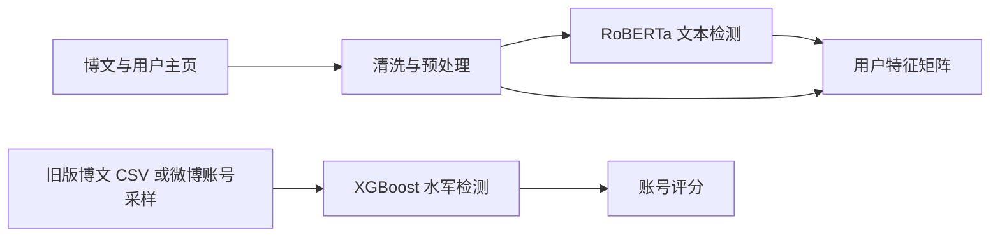
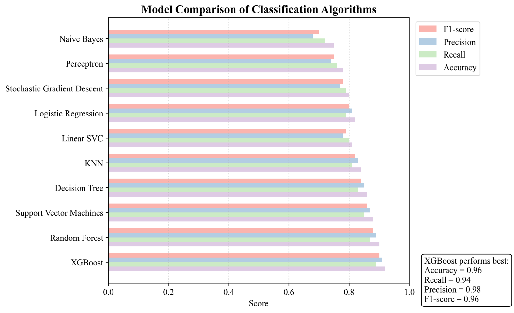
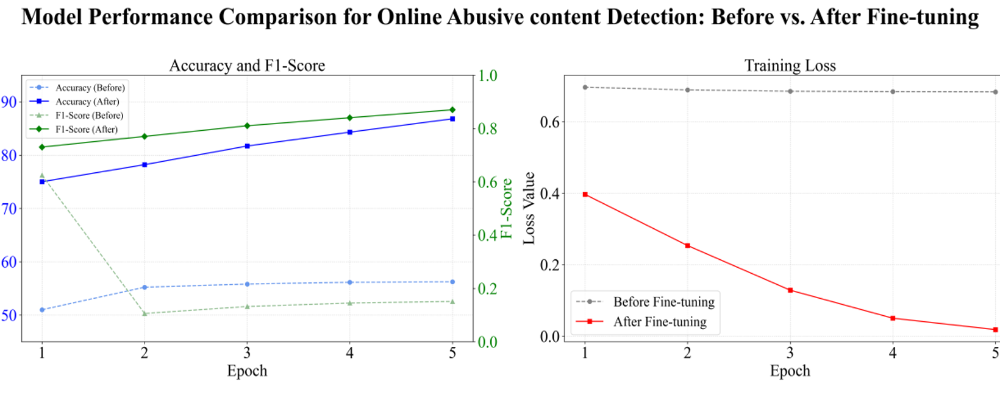

# 社交媒体破坏性用户角色的识别与刻画

**微博用户角色研究原型** · 数据采集、中文攻击性文本检测与账号特征提取

[English](README.md) | **简体中文** | [日本語](README_ja.md)

在仓库根目录运行 `python -m streamlit run app.py --server.port 8502`，然后打开 [本地 Streamlit 演示](http://127.0.0.1:8502/)。

> 作者：Huiyu Jiang。仅用于学术研究。

- **网络水军（Cyber Water Army）** [1]。通过协同行动进行非真实传播的账号群体。
- **网络喷子（Cyber Trolls）** [2]。独立实施恶意人身攻击的用户。

## 研究概览

微博舆情事件中，协同放大和针对个人的攻击都可能加剧网络暴力。本研究以微博为案例，目标是结合多维度特征，识别并刻画网络水军与网络喷子两类账号，为研究网络暴力的传播过程和平台治理提供依据。

本项目研究微博上的两类破坏性用户角色：可能参与协同放大的网络水军，以及发表针对个人攻击内容的网络喷子。仓库提供微博采集、文本检测和用户特征工程代码。仓库提供基于历史标签重建的 XGBoost 水军检测基线。



| 特征维度 | 示例 |
|---|---|
| 内容 | 攻击性文本占比、文本相似度、@ 与链接占比 |
| 网络结构 | 互动网络的度中心性 |
| 行为 | 转发与原创的比率 |
| 用户画像 | 关注与粉丝的比率、阳光信用、VIP 等级、昵称中的数字占比 |

## 研究结果 · 微博「胖猫事件」

多分类方案用一个 XGBoost 模型，依据协同传播与人身攻击两类行为信号，将账号分为网络水军、网络喷子或其他。每个 UID 需要一个确定的标签。若账号同时符合两类，需按预先确定的规则复核并归类。

| 人工标注任务 | 正例 | 负例 |
|---|---:|---:|
| 网络水军 | 200 | 400 |
| 网络喷子 | 40 | 80 |

上表是两项人工标注任务的数量。构建多分类数据时，按 UID 合并标签，确认两个角色的标注后再确定「其他」类。一项任务的负例仍可能属于另一类。两项任务的正负比例都是 1:2，但喷子正例只有水军的五分之一，少数预测变化就可能明显影响喷子类的精确率、召回率和 F1。评估时应同时报告各类的测试样本数、分项指标与宏平均 F1。[1] 和 [2] 分别指 Nian 等人与 Swed 等人的研究。

选定模型后，对 **11,581 名用户**发布的 **21,963 条博文**开展全量识别。

| 账号角色 | 全量识别中的疑似账号数 |
|---|---:|
| 网络水军 | **1,392** |
| 网络喷子 | **145** |

在提供的分类模型对比图中，XGBoost 排名最高。图中标注给出的准确率为 **0.96**，精确率为 **0.98**，召回率为 **0.94**，F1 为 **0.96**。



## 实现进度

| 组件 | 状态 |
|---|---|
| 博文与用户主页采集 | 仓库提供代码 |
| 中文 RoBERTa 文本检测 | 仓库提供训练、批量推理与 Streamlit 演示 |
| 用户特征工程 | 仓库提供代码 |
| XGBoost 水军检测 | 已实现，见 [src/water_army.py](src/water_army.py)，支持训练、留出集评估和批量预测。 |
| 账号角色分类研究 | 结果见上文 |

后续拟制定账号级标注规范，人工复核样本，按 UID 划分训练与测试数据，并按类别报告精确率、召回率与 F1。若将水军检测分数用作特征，评估应使用独立的人工标签。

## 运行 XGBoost 水军检测基线

将两份原始 CSV 保存在本地，例如 `data/raw/legacy_posts.csv`（含「楼主ID」「话题内容」等原始中文列）和 `data/raw/labels.csv`（含 `uid`、`bot`）。从仓库根目录运行：

```bash
pip install "xgboost>=2" pandas scikit-learn networkx
python src/water_army.py train --posts data/raw/legacy_posts.csv --labels data/raw/labels.csv --model models/water_army.json
python src/water_army.py predict --posts data/raw/legacy_posts.csv --model models/water_army.json --out data/raw/water_army_predictions.csv
```

脚本按 UID 汇总用户画像、文本和互动量，每个账号只进入训练集或测试集之一。训练忽略空白标签，发现冲突标签时报错。训练输出模型和 `water_army.metrics.json`，预测输出每个账号的 `uid,bot,bot_score`，可用 `--threshold` 设置分数阈值，默认 0.5。

历史 `bot` 用作训练和评估的参考标签，`bot_score` 不参与训练。留出集指标衡量新模型与历史标签的一致程度，真实检测效果需要人工复核。对训练来源的整份博文表执行预测可检查导出流程，评估请看留出集报告。

在仓库根目录运行 `py -m streamlit run app.py`。在「XGBoost 水军风险」输入数字 UID，并上传旧版博文 CSV，或在本地 `.env` 配置 `WEIBO_COOKIE` 后请求该账号的一页微博。登录、验证或限流会停止采集，可以切换到 CSV。页面默认读取 `models/water_army.json`，也可以通过 `WATER_ARMY_MODEL` 指定。实时采样与训练时的事件窗口不同，分数供人工复核。

配置自己的微博会话后，可以先运行以下命令检查账号资料与一页博文能否读取。将示例数字换成目标 UID。

```bash
python src/crawler/user_profile_crawler.py --check-uid 1234567890
```

旧版博文 CSV 使用原始中文列名。下文话题爬虫生成的 CSV 使用另一套列名。

## 目录结构

```
├── app.py                      # Streamlit：账号评分与文本检测
├── requirements.txt
├── .env.example                # 复制为 .env，填入你自己的 Cookie
├── data/README.md              # 训练语料的获取方式
└── src/
    ├── preprocess.py           # 训练与推理共用的文本清洗
    ├── utils.py                # 用户ID哈希（匿名化）
    ├── features.py             # 生成用户特征矩阵
    ├── water_army.py           # XGBoost
    ├── crawler/
    │   ├── weibo_crawler.py
    │   └── user_profile_crawler.py
    └── abuse_detector/
        ├── train.py            # 微调 RoBERTa
        ├── detector.py         # 批量推理
        └── predict_csv.py      # 给爬取的 CSV 打标签
```

## 快速开始

```bash
pip install -r requirements.txt
cp .env.example .env            # 填入 WEIBO_COOKIE（你自己的账号）和 ANON_SALT
```

**1. 爬取博文和用户主页**（原始数据仅保存在本地，已被 git 忽略）

```bash
python src/crawler/weibo_crawler.py --keyword "<话题>" \
    --start "2024-05-03 19:00" --end "2024-05-03 20:00" --max-pages 20 --out data/raw/topic_posts.csv
python src/crawler/user_profile_crawler.py --in data/raw/topic_posts.csv --out data/raw/profiles.csv
```

**2. 用辱骂检测器给博文打标签**

```bash
python src/abuse_detector/predict_csv.py --model "models/cyberbullying_roberta" \
    --in data/raw/topic_posts.csv --out data/raw/posts_scored.csv
```

**3. 生成特征矩阵**

```bash
python src/features.py --posts data/raw/posts_scored.csv \
    --profiles data/raw/profiles.csv --out data/features.csv
```

**4.（可选）运行 demo**

```bash
python -m streamlit run app.py
```

注意：互动网络由 @ 关系构建，而 @ 只含昵称，所以第 3 步需要**未匿名化**的数据（爬取时不加 `--anonymize`）。请在本地运行，只公开匿名化、聚合后的结果。

## 辱骂检测器

- **基座模型：** `hfl/chinese-roberta-wwm-ext-large`，微调为二分类（辱骂 / 非辱骂）。
- **语料：** 三个公开数据集的合并：ToxiCN [1]、COLD [2]、SWSR [3]。本仓库不提供再分发，获取方式见 `data/README.md`。
- **训练设置：** AdamW，学习率 5e-5，权重衰减 0.01，100 步 warmup，5 个 epoch，batch size 32，最大长度 128；按 8:1:1 分层划分训练/验证/测试集。保留验证集 F1 最高的一轮，测试集只在最后使用一次。
- **指标：** 运行 `train.py` 后，模型目录下会生成 `training_log.json` 和 `test_metrics.json`。

```bash
python src/abuse_detector/train.py --data corpus.csv --out models/cyberbullying_roberta
```

RoBERTa 默认读取 `models/cyberbullying_roberta`。可在本地 `.env` 用 `ABUSE_MODEL` 指定其他权重目录或兼容的 Hub 模型。

### RoBERTa 微调结果与检测实例



| 编号 | 样本内容（概述） | 真值 | 预测 | 结果 |
|---:|---|---:|---:|---|
| 1 | 指责当事人撒谎、对他人死亡漠不关心 | 1 | 1 | 命中 |
| 2 | 辱骂当事人，并以性取向贬损 | 1 | 1 | 命中 |
| 3 | 用贬称指代当事人，并声称指控已被证实 | 1 | 1 | 命中 |
| 4 | 指责当事人隐瞒恋情并与他人暧昧 | 1 | 0 | 漏检 |

`1` 表示攻击性文本，`0` 表示未判为攻击性文本。

## 数据与伦理

- **不分发任何数据。** 爬取的微博数据和训练语料均不包含在仓库里。语料请从原发布方获取，并遵守其使用条款。
- **匿名化。** 爬虫支持对用户 ID 加盐哈希，并丢弃昵称与简介（`--anonymize`）。不要公开用户级的原始数据。
- **凭证安全。** Cookie 保存在 `.env`（已被 git 忽略），切勿提交。
- **平台规则。** 只使用你自己的账号，遵守微博服务条款、访问频率限制和相关法律。爬虫仅用于学术研究，不用于大规模或商业采集。
- **负责任的使用。** 输出结果是概率性的，不要据此公开给个人账号贴标签、骚扰或采取行动。

## 局限性

- 只研究了一个平台上的一起事件，特征和阈值未必能迁移到其他场景。
- 辱骂检测器继承了三个语料的偏差和标注取舍，可能误判反讽、引用和被挪用的脏话。
- 转发/原创比是基于每个用户最近一部分微博的抽样估计。
- 现有检测标签只能用于描述该检测器在这批样本上的输出。

## 参考文献

1. Lu, J., Xu, B., Zhang, X., et al. Facilitating Fine-grained Detection of Chinese Toxic Language: Hierarchical Taxonomy, Resources, and Benchmarks. *Proceedings of the 61st Annual Meeting of the ACL*, Toronto, Canada, 2023, vol. 1, pp. 16235–16250.
2. Deng, J., Zhou, J., Sun, H., et al. COLD: A Benchmark for Chinese Offensive Language Detection. *Proceedings of EMNLP 2022*, Abu Dhabi, UAE, pp. 11580–11599.
3. Jiang, A., Yang, X., Liu, Y., et al. SWSR: A Chinese Dataset and Lexicon for Online Sexism Detection. *Online Social Networks and Media*, 2022, 27:100182.
4. Nian, F., et al. A study on the propagation of online public opinion by internet water army. 2024.
5. Swed, O., et al. Keeping it authentic: the social footprint of the trolls' network. 2023.
